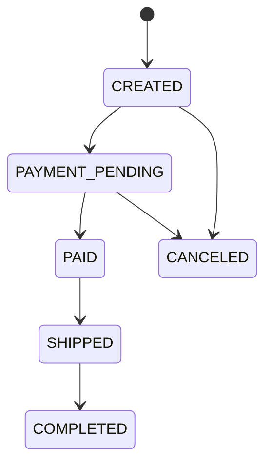

# Marketplace: OpenAPI + CRUD

Я реализовал API маркетплейса на Python: каталог товаров, оформление и изменение заказов, промокоды, JWT-авторизацию и разграничение доступа по ролям. Контракт OpenAPI служит источником DTO, HTTP-хэндлеров, правил проверки входных данных и документации Swagger UI

## Запуск

Все команды выполняются из `tasks/02-openapi_crud`. Нужны Docker Desktop с запущенным Docker Engine и Docker Compose v2

```bash
cd tasks/02-openapi_crud
docker compose up --build --wait
docker compose ps -a
curl -i http://localhost:8000/health
```

При сборке генерируются DTO и маршруты FastAPI. PostgreSQL проходит healthcheck, затем Flyway применяет миграции и только после успешного завершения запускается API. Данные сохраняются в именованном Docker volume

| Адрес | Назначение |
| --- | --- |
| http://localhost:8000/docs | Swagger UI с авторизацией через кнопку Authorize |
| http://localhost:8000/openapi.json | Исходный контракт в JSON |
| http://localhost:8000/health | Проверка подключения к PostgreSQL |
| localhost:5433 | PostgreSQL, БД `marketplace`, пользователь и пароль `marketplace` |

Для локальной демонстрации автоматически создаётся администратор `admin` с паролем `AdminPass123`. Повторный запуск сохраняет существующую учётную запись. Публичная регистрация разрешает только USER и SELLER

Настройки приведены в [.env.example](.env.example). При необходимости можно скопировать его в `.env` и изменить `API_PORT`, `DB_PORT`, `JWT_SECRET`, `POSTGRES_PASSWORD`, `ADMIN_USERNAME`, `ADMIN_PASSWORD` и `ORDER_INTERVAL_MINUTES`. Значения по умолчанию предназначены для локального запуска. Пароль PostgreSQL в `DATABASE_URL` должен быть URL-encoded, если в нём есть специальные символы

Для остановки с сохранением данных:

```bash
docker compose down
```

Flyway запускается отдельным контейнером с зафиксированной версией. Для него указана платформа `linux/amd64`, поскольку выбранный образ не содержит ARM-манифест; Docker Desktop на Apple Silicon выполняет его через эмуляцию

## Проверка решения

Полный набор интеграционных тестов запускается одной командой:

```bash
make test
```

Скрипт создаёт отдельную БД `marketplace_test`, применяет к ней миграции **через Flyway**, собирает приложение и запускает pytest внутри контейнера. При повторном запуске пересоздаётся только тестовая БД. Рабочая БД `marketplace` сохраняется

Тесты обращаются к реальному PostgreSQL через HTTP-слой FastAPI. Проверяются ограничения полей и форматы ответов по исходной OpenAPI-схеме, CRUD, права всех ролей, JWT и ротация refresh token, состояния заказов, расчёт скидок, возврат остатков и откат транзакций. Параллельные запросы проверяют последний остаток товара, последнее использование промокода, два заказа одного пользователя и одновременное обновление refresh token

Воспроизводимый E2E-сценарий через работающий HTTP-сервис:

```bash
docker compose exec api python -m scripts.demo
make inspect
docker compose logs --tail=20 api
```

Сценарий создаёт уникальных пользователей и товары, оформляет заказ со скидкой, изменяет состав, проверяет снятие промокода и снапшот цены, отменяет заказ, проходит цепочку состояний второго заказа, архивирует товар и обновляет токены. Для ошибочных запросов проверяются HTTP-статус и `error_code`. Скрипт можно запускать повторно

Команда `make inspect` выполняет настоящие `SELECT` по таблицам пользователей, товаров, заказов, позиций, промокодов и операций. Также показывает `flyway_schema_history` и индексы. Для произвольных запросов:

```bash
docker compose exec db psql -U marketplace -d marketplace
```

```sql
SELECT id, name, stock, status, seller_id FROM products;
SELECT id, user_id, status, total_amount, discount_amount FROM orders;
SELECT order_id, product_id, quantity, price_at_order FROM order_items;
SELECT code, current_uses, max_uses FROM promo_codes;
SELECT user_id, operation_type, created_at FROM user_operations;
```

## Соответствие критериям

| Балл | Реализация | Где смотреть |
| --- | --- | --- |
| 1 | CRUD товаров, пагинация с нуля, фильтры `status` и точная `category`, `totalElements` | `marketplace.yaml`, `app/products.py` |
| 2 | Отдельные ProductCreate, ProductUpdate, ProductResponse, UUID, decimal, date-time, required и nullable | `src/main/resources/openapi/marketplace.yaml` |
| 3 | Воспроизводимая генерация DTO и HTTP-хэндлеров при сборке, результат исключён из Git | `scripts/generate.py`, `Dockerfile`, `.gitignore` |
| 4 | PostgreSQL, миграции Flyway, индекс `status`, автоматические даты, мягкое удаление | `db/migration/V1__marketplace.sql` |
| 5 | Единый формат ошибок и весь обязательный каталог кодов | OpenAPI `components/responses`, `app/errors.py`, `app/main.py` |
| 6 | Проверка контракта до бизнес-логики, конкретные поля в `details.violations` | `app/contract.py` и сгенерированные DTO |
| 7 | Транзакции заказов, резервы, состояния, снапшоты цен, промокоды, лимиты операций | `app/orders.py`, таблицы `orders`, `order_items`, `promo_codes`, `user_operations` |
| 8 | JSON-лог каждого запроса, UUID, длительность, пользователь, маскирование паролей и токенов | `app/logging.py` |
| 9 | Access JWT на 20 минут, refresh JWT на 14 дней, регистрация, вход, обновление | `app/auth.py` |
| 10 | USER, SELLER, ADMIN, ограничения операций и владение товарами/заказами | OpenAPI `security` и `x-roles`, `app/auth.py`, `app/products.py`, `app/orders.py` |

## Контракт и генерация

Спецификация расположена в [src/main/resources/openapi/marketplace.yaml](src/main/resources/openapi/marketplace.yaml). Я описал контракт до реализации обработчиков. `datamodel-code-generator` создаёт Pydantic DTO, а `scripts/generate.py` по `operationId`, параметрам, телу запроса, успешному ответу и `x-roles` генерирует функции и маршруты FastAPI. Сгенерированные функции вызывают бизнес-операции из `app/operations.py`

Результаты находятся в `generated/models.py` и `generated/routes.py` и исключены из Git. Ручных DTO нет: `app/models.py` содержит только модели хранения SQLAlchemy, `app/schema.py` задаёт общие параметры сериализации. При чистой Docker-сборке код генерируется автоматически

Для локальной разработки нужен Python 3.12:

```bash
python3.12 -m venv .venv
source .venv/bin/activate
pip install -r requirements.txt
make generate
make lint
```

Отдельная команда генерации без Make:

```bash
python -m scripts.generate
```

Зависимости, включая транзитивные, зафиксированы в `requirements.txt`. Тест проверяет, что повторная генерация даёт те же файлы

## API и права

| Операция | USER | SELLER | ADMIN |
| --- | --- | --- | --- |
| GET `/products`, GET `/products/{id}` | Все товары | Все товары | Все товары |
| POST `/products` | 403 | Свой товар | Любой продавец через `seller_id` |
| PUT, DELETE `/products/{id}` | 403 | Только свой товар | Любой товар |
| POST `/orders` | Свой заказ | 403 | Свой заказ |
| GET, PUT `/orders/{id}`, POST `/orders/{id}/cancel` | Только свой заказ | 403 | Любой заказ |
| POST `/promo-codes` | 403 | Разрешено | Разрешено |
| POST `/orders/{id}/status` | 403 | 403 | Разрешено |

`POST /orders/{id}/status` добавлен для прохождения обязательной модели состояний. Он доступен только ADMIN и принимает `PAYMENT_PENDING`, `PAID`, `SHIPPED` или `COMPLETED`. Пропуск состояния, повторный переход и переход из конечного состояния возвращают `INVALID_STATE_TRANSITION`. Явная отмена выполняется через `/cancel`



Все операции с товарами, заказами и промокодами требуют access JWT. Без токена возвращается `401 TOKEN_INVALID`, с просроченным токеном - `401 TOKEN_EXPIRED`. Refresh JWT нельзя использовать как access JWT. Старый refresh token после успешной ротации становится недействительным. В БД хранится SHA-256 токена, пароли хранятся как Argon2id-хеши

Пример входа:

```bash
curl -s http://localhost:8000/auth/login \
  -H 'Content-Type: application/json' \
  -d '{"username":"admin","password":"AdminPass123"}'
```

Полученный `access_token` передаётся в `Authorization: Bearer <access_token>`. В Swagger UI достаточно вставить его в Authorize

Пример создания товара:

```bash
curl -i http://localhost:8000/products \
  -H 'Authorization: Bearer <access_token>' \
  -H 'Content-Type: application/json' \
  -d '{"name":"Keyboard","price":100,"stock":5,"category":"electronics","status":"ACTIVE"}'
```

`GET /products` по умолчанию возвращает `page=0`, `size=20`. Размер страницы ограничен диапазоном 1–100. Список упорядочен по `created_at`, затем `id`; `totalElements` учитывает фильтры. Архивные товары сохраняются в БД и доступны для чтения, но оформить их в заказ нельзя. PUT товара заменяет все редактируемые поля; пропущенное описание становится `null`

## Транзакции и бизнес-правила

Каждая бизнес-операция выполняется в `SessionLocal.begin()`. Ответ формируется из сгенерированного DTO, транзакция коммитится до возврата HTTP-ответа. Исключение откатывает изменение остатков, заказа, счётчика промокода и запись операции

При создании заказа сначала блокируется строка пользователя через `SELECT FOR UPDATE`. Это сериализует операции одного пользователя, включая проверку лимита. Затем выполняются проверки строго по условию: частота создания, активный заказ, существование и активность товаров, достаточность остатков. Дополнительно частичный уникальный индекс запрещает два заказа одного пользователя в состояниях CREATED или PAYMENT_PENDING

Товары блокируются в порядке UUID, затем блокируется промокод. Единый порядок уменьшает риск взаимных блокировок. Блокировка товара защищает проверку и уменьшение `stock` от конкурентной продажи последней единицы; блокировка промокода защищает `current_uses`

Для обновления заказа я проверяю владельца, состояние CREATED и отдельный лимит UPDATE_ORDER. Старые остатки возвращаются перед проверкой новых позиций в той же транзакции. Все новые позиции получают текущие цены; уже сохранённые позиции не меняются от редактирования каталога. Повторный `product_id` в теле запроса отклоняется как `VALIDATION_ERROR` до бизнес-логики через контрактное расширение `x-unique-by`

Лимит создания и обновления по умолчанию равен одной минуте. `ORDER_INTERVAL_MINUTES` поддерживает дробные значения и 0 для отключения ожидания. CREATE_ORDER и UPDATE_ORDER учитываются раздельно; неуспешные операции не записываются. При ограничении частоты ответ содержит `Retry-After` и `details.retry_after_seconds`

При отмене разрешены только CREATED и PAYMENT_PENDING. Остатки возвращаются и использование промокода освобождается одной транзакцией. Повторная отмена запрещена, поэтому повторного возврата остатков нет

Деньги хранятся как PostgreSQL `NUMERIC(12,2)` и обрабатываются через Python `Decimal`. API принимает JSON-числа с точностью до копейки; цены должны быть не меньше 0.01. Итог округляется до копеек по ROUND_HALF_UP, а переполнение денежного диапазона отклоняется как ошибка валидации

Для промокодов реализованы следующие правила:

- PERCENTAGE до 70% включительно уменьшает сумму на заданный процент; свыше 70% скидка равна нулю и оплачивается полная цена, согласно фразе «в ином случае цена 100%» в условии
- FIXED_AMOUNT ограничивается суммой заказа, поэтому итог не становится отрицательным
- Время проверяется в UTC, границы `[valid_from, valid_until]` включены
- При обновлении промокод проверяется заново; если сумма ниже минимума, промокод снимается и `current_uses` уменьшается
- Обновление сохраняет уже занятое использование промокода даже при `current_uses == max_uses`; повторного увеличения счётчика нет
- Истёкший или неактивный промокод при обновлении вызывает `PROMO_CODE_INVALID` с откатом операции

Даты создания и обновления заполняет PostgreSQL: DEFAULT и триггеры. Изменение строки через SQL также обновляет `updated_at`

## Ошибки и логи

Пример ошибки валидации:

```json
{
  "error_code": "VALIDATION_ERROR",
  "message": "Invalid input",
  "details": {
    "violations": [
      {"field": "body.price", "message": "0 is less than the minimum of 0.01"}
    ]
  }
}
```

Недостаток товара возвращает `409 INSUFFICIENT_STOCK` со списком `details.products`, содержащим `product_id`, `requested_quantity` и `available_stock`. Права на чужой заказ дают `ORDER_OWNERSHIP_VIOLATION`; запрет роли или управление чужим товаром - `ACCESS_DENIED`. Неверные UUID, query-параметры, типы JSON, отсутствующие и лишние поля, некорректный JSON также проходят через единый формат ошибок

Middleware генерирует новый UUID для каждого запроса и возвращает его в `X-Request-Id`. JSON-лог содержит `request_id`, `method`, `endpoint`, `status_code`, `duration_ms`, `user_id`, `timestamp`. Для POST, PUT и DELETE добавляется `request_body`, пароли, токены и вложенные чувствительные поля заменяются на `***`. Стандартный access-log Uvicorn отключён

## Структура

```text
app/
  auth.py              # JWT, пароли, регистрация, вход, refresh
  config.py            # конфигурация
  contract.py          # проверка запросов по OpenAPI
  db.py                # SQLAlchemy engine и сессии
  errors.py            # единый формат ошибок
  logging.py           # JSON-логи и X-Request-Id
  main.py              # сборка приложения
  models.py            # модели хранения, не DTO
  operations.py        # транзакционная граница и диспетчеризация
  orders.py            # заказы, резервы, состояния, скидки
  products.py          # каталог и создание промокодов
  schema.py            # общие настройки сгенерированных DTO
  seed.py              # создание администратора
db/migration/          # версионированные миграции Flyway
src/main/resources/openapi/marketplace.yaml
scripts/               # генерация, E2E, SQL для защиты, запуск тестов
tests/                 # интеграционные и конкурентные проверки
generated/             # генерируется при сборке, исключена из Git
Dockerfile
docker-compose.yml
Makefile
requirements.in
requirements.txt
```

## Что объяснять на защите

1. **Contract-first и code-first**: здесь сначала описывается OpenAPI, затем из него генерируются типы и хэндлеры; `/openapi.json` возвращает этот же контракт
2. **Транзакция и уровень READ COMMITTED**: атомарность даёт общий commit/rollback, а `FOR UPDATE` защищает конкретные проверки остатков и лимитов от гонок
3. **Почему недостаточно обычного SELECT**: два запроса могут одновременно увидеть один остаток; блокировка заставляет второй дождаться и прочитать уже изменённую строку
4. **NUMERIC и Decimal**: расчёт стоимости не использует двоичную арифметику float; JSON-число появляется только при сериализации ответа
5. **Снапшот цены**: цена позиции сохраняется в order_items и не зависит от будущих изменений products.price
6. **JWT и refresh**: подпись проверяет подлинность claims, `exp` ограничивает срок, `type` разделяет назначение токенов, ротация запрещает повторное использование refresh token
7. **Роли и владение**: роль разрешает класс операций, сравнение seller_id/user_id ограничивает доступ к конкретной записи
8. **Flyway**: версии и контрольные суммы миграций хранятся в flyway_schema_history; миграции не выполняются через ORM create_all

Основные источники: [генерация Pydantic-моделей из OpenAPI](https://github.com/datamodel-code-generator/datamodel-code-generator), [блокировки PostgreSQL](https://www.postgresql.org/docs/current/explicit-locking.html), [PyJWT](https://pyjwt.readthedocs.io/en/stable/usage.html), [Flyway CLI и Docker](https://documentation.red-gate.com/flyway/reference/usage/command-line)
