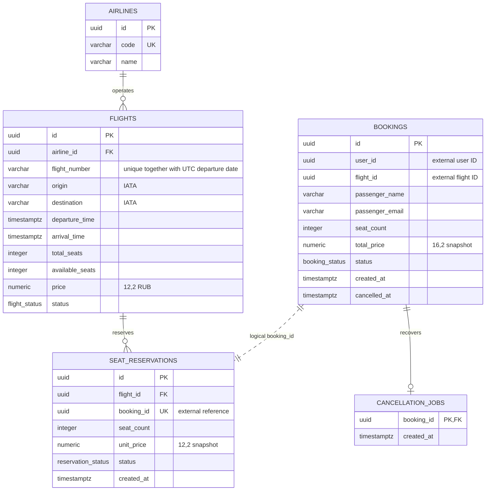
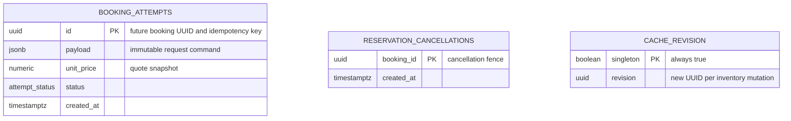

# Схема данных и 3NF

Я разделил хранение на две независимые PostgreSQL: `flights` и `bookings`. Сервисы не читают чужую БД. Пунктирная связь между сервисами обозначает общий UUID, физического внешнего ключа между БД нет.

Технические таблицы восстановления и кеширования:

`booking_attempts` и `cancellation_jobs` находятся в Booking DB; `reservation_cancellations` и `cache_revision` — в Flight DB. Каждая БД также содержит собственную `alembic_version`.

В основных сущностях все значения атомарны, первичные ключи простые, неключевые атрибуты описывают соответствующий рейс, резервацию или бронирование. Название авиакомпании вынесено в `airlines`: зависимость `airline_id → name` не дублируется в `flights`. Таблица рейсов хранит только IATA-коды, без зависимых названий аэропортов. ФИО и email в Booking описывают пассажира конкретного бронирования, который может отличаться от владельца `user_id`.

Дата вылета отдельно не хранится: уникальность `(flight_number, UTC departure date)` задаёт индекс по выражению. В Booking хранится историческая итоговая цена, без копии текущей цены рейса и без отдельного вычисляемого `unit_price`. Цена в резервации также является историческим фактом, а не копией изменяемой цены рейса. JSONB в `booking_attempts` — журнал неизменяемых команд для восстановления; это не альтернативная модель бизнес-сущностей.

Ограничения закреплены в SQL-миграциях:

- `total_seats > 0`, `0 <= available_seats <= total_seats`, `seat_count > 0`, `price > 0`, `total_price > 0`;
- IATA соответствует `^[A-Z]{3}$`, аэропорты различаются, прилёт позже вылета;
- уникальны код авиакомпании, номер рейса с датой UTC и `seat_reservations.booking_id`;
- статусы ограничены PostgreSQL ENUM; `cancelled_at` заполнен тогда и только тогда, когда Booking отменён;
- локальные связи защищены FK, межсервисные операции — контрактом, идемпотентностью и журналом восстановления.

`available_seats` — явно требуемый условием счётчик. Я поддерживаю инвариант `available_seats + SUM(ACTIVE.seat_count) = total_seats` в одной транзакции под блокировкой рейса. Возврат мест и изменение статуса резервации коммитятся вместе.
